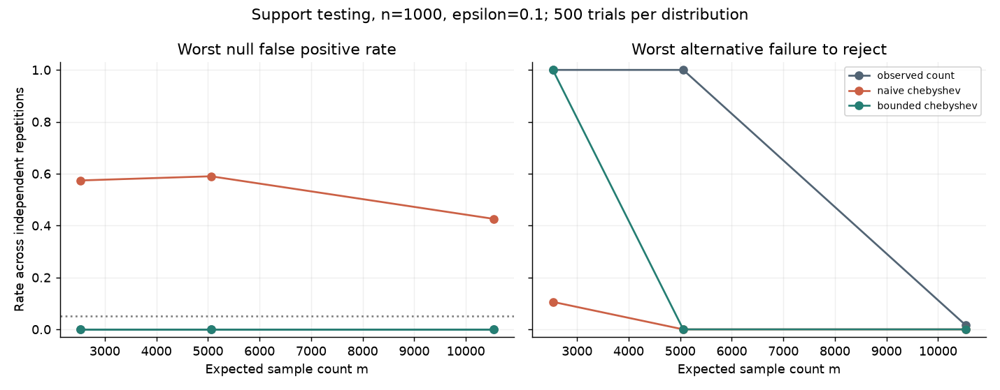
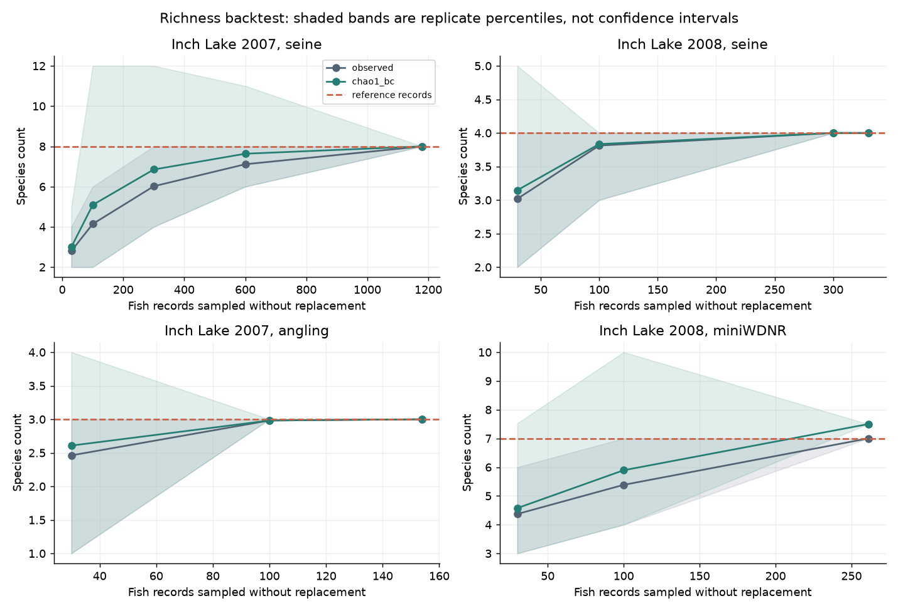

新的多领域、大规模实验见 [扩展实验报告](results_large/report.html)，覆盖五套公开数据、百万级检验阈值和上亿类别的构造总体。下文保留原鱼类实验及其参数，便于比较两次实验的范围。

对应性审计说明：本报告中的小预算多项式结果属于工程修正版，与论文第 3 节的完整参数及随机误差修正不同。严格原版入口和逐式核对见 [审计报告](results_audit/report.html)；以下历史实验数值保持原样。

已经完成可运行代码、论文公式核对、合成分布检验和真实鱼类捕获记录回测。实验显示：有限样本修正能显著降低多项式的误报；对于稀有鱼种，少量捕获记录仍不足以稳定恢复全部类别。当前证据不支持声称已经准确估计贝加尔湖或 Inch Lake 的全湖鱼种总数。

本报告对应种子 `20261016`、每组 500 次重复，默认参数 `n=1000, epsilon=0.1, alpha=0.05`。结果由当前目录的程序实际运行生成，不是论文中的实验。运行方式和新概率界的推导见 [README](README.md)。

**可执行规模与改进**

| 方案 | n=1000、epsilon=0.1 时的预算 | 含义 |
|---|---:|---|
| 论文第 3 节原始参数 | 84,864,619,140 | 现实 n 下进入直接计数分支 |
| 原分析中的 Markov 计数方案，alpha=0.05 | 200,200 | 误报为 0，漏报上界 5% |
| 本实现的泊松尾界计数方案，alpha=0.05 | **10,537** | 同样的承诺检验保证，使用更紧的发现过程尾界 |
| 本实现的二项尾界计数方案，alpha=0.05 | **10,509** | 固定样本量下的对应保证 |
| 实验多尺度多项式 | 2,530 / 5,059 / 10,537 | 修正后有单侧误报控制；小预算下的漏报需单独检查 |

新的计数基线求解 `Pr(Poi(m*epsilon)<=n)<=alpha` 或 `Pr(Bin(M,epsilon)<=n)<=alpha`。它仍是 `O(n/epsilon)` 阶，不能替代论文的渐近最优性结论。

另外，模拟时直接生成各类别的泊松计数，不展开 M 个标签。原文的巨大预算也已实际跑通：例如均匀 1,000 类，期望 m 为 84,864,619,140，本次模拟的实际 M 为 84,864,707,621，最终 D=1,000。这里没有在现实中采集约 849 亿条观测；这是泊松模型的等价模拟。记录见 [paper_parameters_simulated_counts.csv](results/paper_parameters_simulated_counts.csv)。

**多项式的模拟效果**

比较使用完全相同的每一批样本。直接缩小参数的对照使用 `B=log(en)`、最多 8 阶，并继续沿用原文 delta 修正。有限样本修正版使用最多 12 阶、权重绝对值不超过 20、实际 rho 和 Hoeffding 余量；这些参数事先固定，没有按以下结果搜索或挑选。

当 m=2,530 时：

| 分布 | 指标 | 直接计数 | 简单缩小参数的多项式 | 有限样本修正多项式 |
|---|---|---:|---:|---:|
| 1,000 类均匀分布 | Yes 情形误报率 | 0% | 57.4% | 0% |
| 1,000 类，一类占 90% | Yes 情形误报率 | 0% | 52.8% | 0% |
| 1,000 类 Zipf 分布 | Yes 情形误报率 | 0% | 50.0% | 0% |
| 2,000 类均匀分布 | No 情形未能拒绝的比例 | 0% | 0% | 0% |
| 1,112 类均匀分布，接近边界 | No 情形未能拒绝的比例 | 58.4% | 10.6% | 52.8% |
| 一类占 80%，其余 100,000 类共享 20% | No 情形未能拒绝的比例 | 100% | 0% | **0.4%** |
| 一类占 89.8%，其余 100,000 类共享 10.2% | No 情形未能拒绝的比例 | 100% | 0% | **100%** |

这说明多项式可帮助发现难以直接数到的稀有类别，但仅凭某个有利案例就宣称普遍成功是不成立的。修正版在最后一行仍未得到足够证据，所以接口返回 `Inconclusive`，不强行给出有保证的 Yes。

在 m=5,059 时，修正版对所测试的 9 种分布各 500 次均无误报或未能拒绝；直接计数在两个长尾 No 分布上仍有 38.6% 和 100% 未能拒绝。**这些是有限测试集合的结果，尚未证明 5,059 对所有分布足够。** 每个配置的 0/500 也不意味着真实错误概率为零，其 95% Wilson 区间上端约为 0.76%。所有分布及区间保存在 [synthetic_results.csv](results/synthetic_results.csv)。

图中画的是所测分布中的最大误差，不是对所有未知分布取上确界；右图的未能拒绝不等同于输出有保证的 Yes。PDF 版见 [synthetic_error_rates.pdf](results/synthetic_error_rates.pdf)。

**找到的真实捕获数据**

采用 [Derek H. Ogle / FSAdata 的 InchLake1](https://fishr-core-team.github.io/FSAdata/reference/InchLake1.html)：美国威斯康星州 Inch Lake，2007 与 2008 年 5 月，逐个体记录。包含 angling（钓鱼）、seine（围网）和不同类型的捕网。原始数据有 4,894 行；排除其中 7 条小龙虾后，剩下 **4,887 条鱼类记录、记录内共 9 种鱼**。

数据已保存为 [原始 CSV](data/InchLake1.csv) 和 [清洗后的逐条记录](data/inch_lake_fish.csv)。下载固定 Git 版本 `2db85a9eaed25f9d13be5a3a5fde5dce0cf125c7`，SHA256 为 `0bcf180122609e77a220a46626004776c36a5176a1e4f663a4c81372b0219584`，来源和限制见 [provenance.json](data/provenance.json)。

该文件没有逐尾时间戳，也没有能识别跨事件重捕的永久鱼编号。每一行可以作为一条捕获记录，但不能把文件顺序解释成真实的每次上钩顺序。分析没有删除体长、物种、网次恰好相同的行，因为它们可能是不同的鱼。

贝加尔湖的检索找到以下来源，但本次没有找到并取得符合要求的开放、多物种逐尾随机捕获数据：

| 来源 | 核查结果 |
|---|---|
| [贝加尔湖环境监测捕捞统计](https://www.baikalake.ru/en/monitoring/gosecomonit/water_bio_resources/amount_extraction/2022/) | 提供年度捕捞吨数；不能转换为独立逐鱼标签 |
| [Baikal sculpins 的 Dryad 数据](https://datadryad.org/dataset/doi%3A10.5061/dryad.cnp5hqcfm) | 定向采集的遗传数据；样本中的物种比例不代表鱼群丰度 |
| [NTL-LTER 的鱼类长度/重量数据目录](https://hdugan.github.io/NTLcoredatasets/) | 数据结构适合继续研究；当前 EDI 下载返回登录页/403，本次未使用其数据 |

这些检索结果不等于证明贝加尔湖此类数据不存在。Inch Lake 是已经完成下载、清洗和计算的替代实证例子。

**鱼种数能估计得多准**

先固定年份和渔具，再从该组所有记录中不放回随机抽样。对照真值是这组完整参考记录中的种数。Chao1 作为鱼种总数的点估计对照，区别于论文的承诺检验。以下每行重复 500 次：

| 参考组 | 完整记录数 / 记录内种数 | 抽取记录数 | 平均直接见到的种数 | Chao1 平均估计 | Chao1 平均绝对误差 |
|---|---:|---:|---:|---:|---:|
| 2007 围网 | 1,180 / 8 | 100 | 4.14 | 5.09 | 3.27 |
| 2007 围网 | 1,180 / 8 | 300 | 6.02 | 6.85 | 1.88 |
| 2007 围网 | 1,180 / 8 | 600 | 7.11 | 7.64 | 1.12 |
| 2008 围网 | 330 / 4 | 100 | 3.81 | 3.83 | 0.21 |
| 2007 钓鱼 | 154 / 3 | 100 | 2.98 | 2.98 | 0.02 |
| 2008 miniWDNR 捕网 | 261 / 7 | 100 | 5.39 | 5.89 | 1.52 |

“平均接近”也不等于每次都准确：2007 围网抽 600 条时，Chao1 均值 7.64 接近 8，但按最近整数取整后恰好为 8 的比例仅 **35.8%**（半整数取偶数）；该场景直接计数的平均绝对误差 0.888 反而低于 Chao1 的 1.118。原始结果没有把估计截断到已知参考种数来美化误差。

2007 围网组最稀有的 Iowa Darter 仅出现 1 次，Tadpole Madtom 仅 2 次。因此抽样比例不高时很容易完全错过它们。另一方面，2007 年钓鱼记录只出现 3 种，而同年围网出现 8 种，体现了采样方法对可观察种类的影响；无法据钓鱼组的结果声称全湖只有 3 种鱼。

阴影表示 500 次抽样结果的 2.5%～97.5% 分位数，**不是全湖真实种数的置信区间**。详细结果见 [fish_subsample_results.csv](results/fish_subsample_results.csv)，可导出的图见 [fish_richness.pdf](results/fish_richness.pdf)。

另做了按完整捕获事件划分的回测。例如 2007 围网共有 15 个事件，每次选择其中 7 个事件作为训练数据，平均有 554 条记录；直接观察平均 6.79 种，Chao1 平均 7.37 种，Chao1 平均绝对误差 1.25。2008 miniWDNR 的事件划分更困难，Chao1 平均绝对误差 1.99。详见 [fish_event_holdout.csv](results/fish_event_holdout.csv)。这保留了事件内的聚集结构，仍只能对照已有记录，不能建立全湖真值。

**论文检验在真实频率形状上的表现**

为满足论文的泊松模型，另把各组真实记录的相对频数当作已知经验分布 p，独立模拟泊松采样。没有在上述不放回子样本上套用泊松独立性保证。

2007 围网的经验分布有 8 种，但两个最常见鱼种占 **97.29%** 的记录。因此 `eff_0.05=2`、`eff_0.01=5`。这说明“有效支持集下界”和“找齐 8 种鱼”是不同目标。

在该经验分布上，m=300、epsilon=0.01 时：

| 阈值 n | 相对经验分布的承诺区域 | 有限样本多项式拒绝比例 |
|---:|---|---:|
| 3 | No | 98.6% |
| 4 | No | 92.4% |
| 5 | Gap | 64.6%，不计为正确或错误 |
| 8 | Yes | 0% |

这里小类别数下，多项式修正版与直接计数的结果相同，未表现出额外收益。所有组、预算、epsilon 和 n 均保存在 [fish_testing_results.csv](results/fish_testing_results.csv)。需要小 epsilon 才能把稀有种纳入检验的“明显超过”条件，预算也会随之提高。

另补充了直接在真实记录子样本上调用多项式的流程：先从固定样本池做一次泊松子抽样，再计算单侧支持集下界。n=20、epsilon=0.01 在评测前固定，避免使用记录内的已知种数设置上限。原始捕获的 iid 条件未经认证，所以只报告经验效果，见 [fish_polynomial_lower_bounds.csv](results/fish_polynomial_lower_bounds.csv)。该流程的 `overflow` 保留为失败/样本不足事件，没有重抽或删除。

这一真实记录流程共评测 15 个配置、每个 500 次：7,500 次中下界均未高于直接观察数，也未超过参考种数，发生 34 次样本池溢出。该结果说明当前保守修正在这些小支持集场景没有额外发现能力，不能用合成长尾分布上的收益来代替真实数据的表现。一个 300 条记录的可复现示例先看到 7 种，泊松化使用预设均值 258.190，实际抽取 251 条，最后仍只给出 7 种的下界，对 n=8 返回 `Inconclusive`。

**验证与后续研究边界**

23 项测试已通过，包括泊松期望恒等式、80/150 位权重一致性、有限样本期望包络、计数尾界对精确占据模型的检查、m 与 M 的区分、固定样本泊松化和溢出处理、巨大次数的直方图聚合、输入边界和鱼类清洗。数学计算没有采用严格区间算术，极端参数的机器舍入不在认证范围内。

用 `.venv/bin/python run_all.py --trials 500 --seed 20261016` 可完整重跑；测试日志、运行配置和真实 CSV 示例分别写入 `results/tests.log`、`results/run_summary.json`、`results/example_*_csv.json`。同一命令也会生成带 SHA256 清单的便携实验压缩包。

当前可交付的成果是：可复现的论文公式实现、普通电脑可执行的模拟方式、有明确有限样本依据的计数方案、控制误报的多项式修正，以及有真实来源和误差评估的鱼类回测。若要形成论文的实证扩展，应进一步补充多湖泊/多渔具数据、独立物种调查真值、预先设定的参数搜索与留出评测，并继续收紧小样本下的多项式漏报分析。
